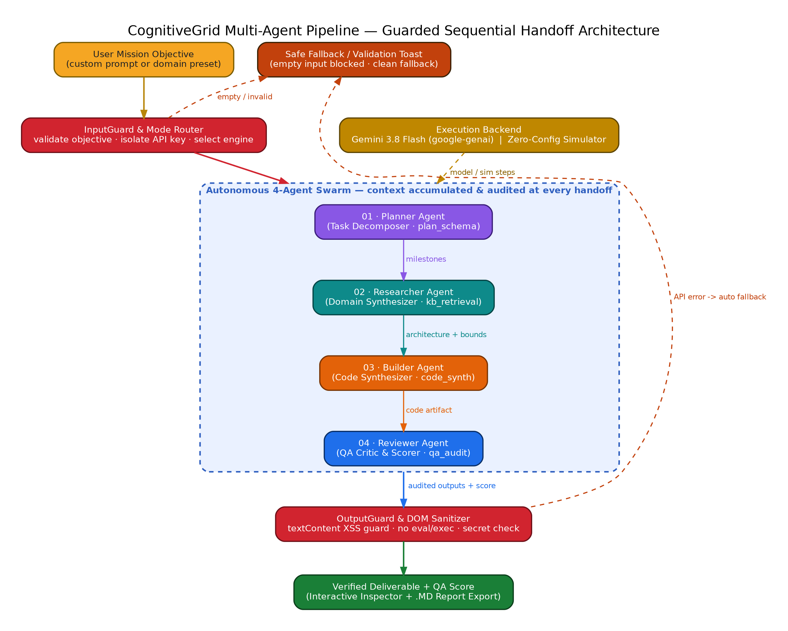
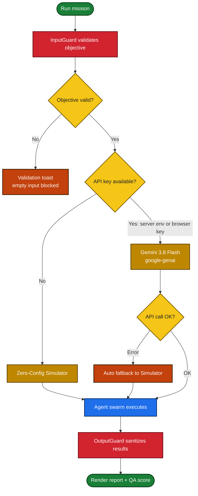
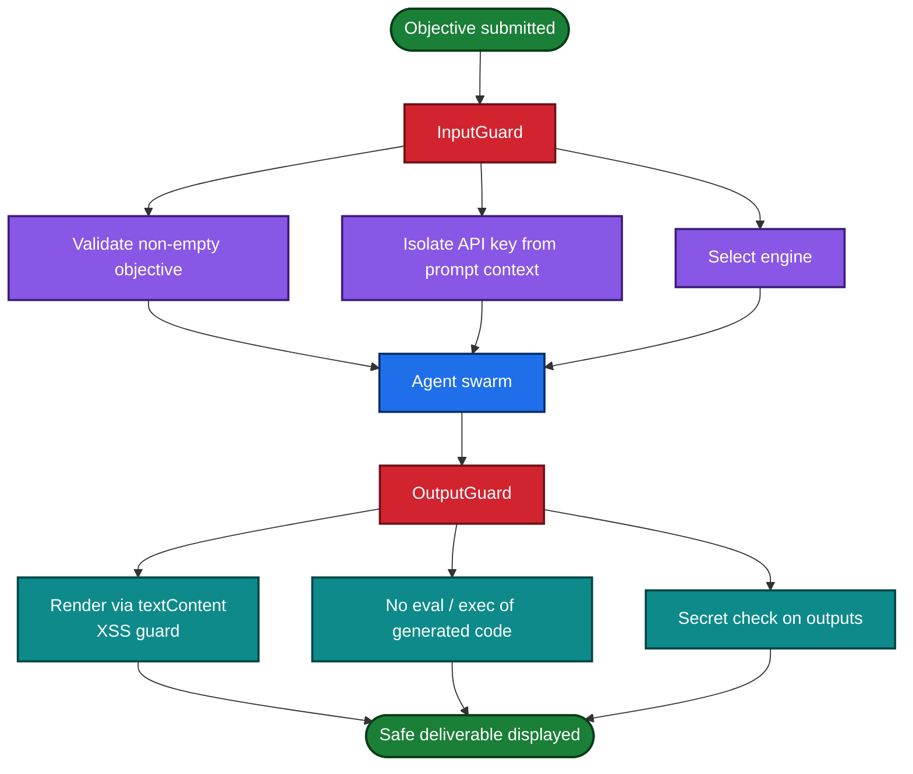
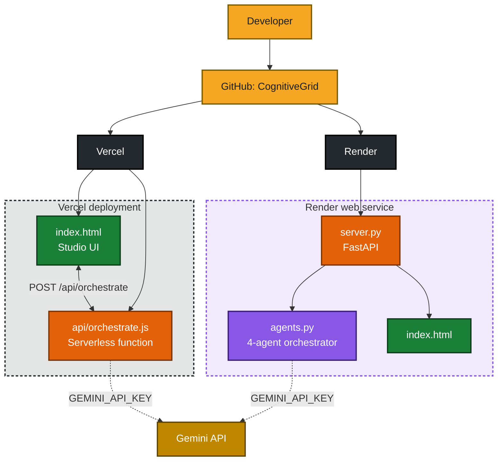

# CognitiveGrid — Agentic AI Multi-Agent Orchestration System

A **Multi-Agent AI System** where four autonomous agents (**Planner**, **Researcher**, **Builder** and **Reviewer**) collaborate on a mission objective through a guarded sequential handoff, with a live visual orchestration studio on top. Every handoff is audited, input and output are guarded, and a clean fallback keeps the studio working even when the model API fails.

- **Live demo:** [CognitiveGrid on Vercel](https://agentic-ai-multiagent.vercel.app/)
- **Repository:** [github.com/sourabhvamdevan/CognitiveGrid](https://github.com/sourabhvamdevan/CognitiveGrid)
- **Deployment platforms:** [Vercel](https://vercel.com/) and [Render](https://render.com/)

**Execution modes**

- **Simulated Engine (default, zero config):** works out of the box on the live URL, so visitors and recruiters never need an API key.
- **Live Gemini API (`gemini-3.8-flash`):** uses the official Google GenAI SDK (`google-genai` / `@google/genai`) through `/api/orchestrate` or a browser-supplied key.

---

## Table of Contents

- [Quick Start](#quick-start)
- [System Architecture and Workflows](#system-architecture-and-workflows)
- [Using the Studio](#using-the-studio)
- [Guardrails and Safety](#guardrails-and-safety)
- [Repository Layout](#repository-layout)
- [API](#api)
- [Deployment](#deployment)
- [Key Design Principles](#key-design-principles)
- [Limitations](#limitations)

---

## Quick Start

### Option A: Open the UI instantly

Open `index.html` in any browser, or serve it locally:

```bash
python -m http.server 8000
```

Then visit [http://localhost:8000](http://localhost:8000).

### Option B: Run the full FastAPI server

```bash
pip install -r requirements.txt
uvicorn server:app --reload --port 8000
```

Open [http://localhost:8000](http://localhost:8000). Interactive API docs are at [http://localhost:8000/docs](http://localhost:8000/docs).

### Option C: Run the CLI orchestrator

```bash
python agents.py "Design a rate-limiter middleware in FastAPI"
```

### Enable live Gemini mode (optional)

```bash
cp .env.example .env
# set GEMINI_API_KEY in .env
```

Without a key, the studio runs in Simulated Engine mode.

---

## System Architecture and Workflows

### 1. High-Level Architecture

The pipeline is a guarded sequential handoff: the user's objective passes through **InputGuard**, flows through the four agents with context accumulating at every step, and the audited result passes through **OutputGuard** before it is shown.



> The diagram source is in [`docs/architecture.dot`](docs/architecture.dot) (Graphviz). Re-render with `dot -Tpng docs/architecture.dot -o docs/architecture.png`.

### 2. Agent Pipeline Workflow

```mermaid
flowchart LR
    U(["Mission Objective"]) --> G["InputGuard<br/>& Mode Router"]
    G --> P["01 Planner<br/>Task Decomposer"]
    P -->|"milestones"| R["02 Researcher<br/>Domain Synthesizer"]
    R -->|"architecture + bounds"| B["03 Builder<br/>Code Synthesizer"]
    B -->|"code artifact"| V["04 Reviewer<br/>QA Critic & Scorer"]
    V -->|"audited outputs + score"| O["OutputGuard<br/>& DOM Sanitizer"]
    O --> D(["Verified Deliverable<br/>+ QA Score"])

    classDef user fill:#f5a623,stroke:#7a5c00,color:#1b1f24,stroke-width:2px
    classDef guard fill:#d1242f,stroke:#6e1018,color:#ffffff,stroke-width:2px
    classDef plan fill:#8957e5,stroke:#3b1e7a,color:#ffffff,stroke-width:2px
    classDef research fill:#0e8a8a,stroke:#054545,color:#ffffff,stroke-width:2px
    classDef build fill:#e36209,stroke:#7a3300,color:#ffffff,stroke-width:2px
    classDef review fill:#1f6feb,stroke:#0a3069,color:#ffffff,stroke-width:2px
    classDef engine fill:#bf8700,stroke:#5c4400,color:#ffffff,stroke-width:2px
    classDef good fill:#1a7f37,stroke:#0b3d1a,color:#ffffff,stroke-width:2px
    classDef warn fill:#c2410c,stroke:#3a1f00,color:#ffffff,stroke-width:2px
    classDef decide fill:#f5c518,stroke:#7a5c00,color:#1b1f24,stroke-width:2px
    classDef dark fill:#24292f,stroke:#000000,color:#ffffff,stroke-width:2px
    class U user
    class G,O guard
    class P plan
    class R research
    class B build
    class V review
    class D good
    style P fill:#8957e5,stroke:#3b1e7a,color:#ffffff
```



| Agent | Role | Tool | Output |
| --- | --- | --- | --- |
| **01 · Planner** | Task Decomposer | `plan_schema` | Structured milestones, tool calls and acceptance criteria |
| **02 · Researcher** | Domain Synthesizer | `kb_retrieval` | Architecture patterns, algorithmic bounds and edge cases |
| **03 · Builder** | Code and Artifact Synthesizer | `code_synth` | Modular implementation code and configuration satisfying the plan |
| **04 · Reviewer** | Critic and QA Verifier | `qa_audit` | Audit against the Planner's criteria and a QA score |

### 3. Execution Engine Selection



### 4. Guardrail Flow



### 5. Deployment Architecture



---

## Using the Studio

1. Enter a custom mission objective, or pick a domain preset.
2. Choose the engine: Simulated (default) or Live Gemini with your API key.
3. Run the mission and watch the four agents execute in sequence, each receiving the accumulated context.
4. Open the **Interactive Inspector** to view each agent's output.
5. Review the Reviewer's **QA score**, then export the full run as a **Markdown report**.

If the objective is empty, a validation toast blocks the run. If the model API errors, the studio automatically falls back to the simulator.

---

## Guardrails and Safety

| Guard | What it does |
| --- | --- |
| **InputGuard** | Validates the objective, isolates the API key and selects the execution engine. |
| **OutputGuard** | Sanitizes agent output before display. |
| **XSS protection** | Agent output is rendered with `textContent`, never as raw HTML. |
| **No code execution** | Generated code is displayed only. There is no `eval` or `exec` of model output. |
| **Secret check** | Outputs are checked so API keys do not leak into rendered results. |
| **Safe fallback** | Empty input is blocked and API errors fall back to the simulator cleanly. |

---

## Repository Layout

```text
CognitiveGrid/
├── index.html           # Self-contained multi-agent studio UI (standalone or with backend)
├── agents.py            # Modular Python 4-agent orchestrator + CLI runner (google-genai)
├── server.py            # FastAPI backend serving index.html and POST /api/orchestrate
├── api/
│   └── orchestrate.js   # Vercel serverless function (@google/genai)
├── docs/
│   ├── architecture.dot # Graphviz source of the architecture diagram
│   └── architecture.png # Rendered architecture diagram
├── vercel.json          # Vercel zero-config routing
├── package.json         # Node dependencies for the Vercel serverless API
├── render.yaml          # Render Blueprint for one-click Python web service deploy
├── requirements.txt     # Python dependencies for Render and local execution
└── .env.example         # Environment variable template
```

---

## API

| Endpoint | Purpose |
| --- | --- |
| `POST /api/orchestrate` | Runs the four-agent pipeline for a given objective and returns each agent's output plus the QA score |

Available on both the FastAPI server (`server.py`) and the Vercel function (`api/orchestrate.js`). Set `GEMINI_API_KEY` on the server for live Gemini calls.

---

## Deployment

**Live application:** [https://agentic-ai-multiagent.vercel.app/](https://agentic-ai-multiagent.vercel.app/)

### Vercel (fastest live link)

1. Push the repository to GitHub.
2. Open [Vercel New Project](https://vercel.com/new) and import the repository.
3. Click **Deploy**. No build command is needed; `vercel.json` serves `index.html` and mounts `/api/orchestrate`.
4. *(Optional)* Add `GEMINI_API_KEY` under **Settings → Environment Variables** for server-side live Gemini calls.

### Render (FastAPI backend and UI)

1. Push the repository to GitHub.
2. In the [Render Dashboard](https://dashboard.render.com), click **New → Web Service** and connect the repository.
3. **Build Command:** `pip install -r requirements.txt`
4. **Start Command:** `uvicorn server:app --host 0.0.0.0 --port $PORT`
5. *(Optional)* Add `GEMINI_API_KEY` in Environment Variables, then click **Create Web Service**.

---

## Key Design Principles

| Principle | Implementation |
| --- | --- |
| Zero-config demo | Simulated engine works on the live URL without any API key. |
| Guarded handoffs | Input and output guards wrap the whole agent swarm. |
| Graceful degradation | API errors fall back automatically to the simulator. |
| Separation of concerns | UI, Python orchestrator, FastAPI server and serverless function are separate modules. |
| Auditability | The Reviewer audits the Builder against the Planner's acceptance criteria and reports a QA score. |
| Deployment flexibility | Vercel and Render configurations are both included. |

---

## Limitations

- Simulated Engine output is scripted demo behaviour, not real model reasoning.
- The QA score is produced by the Reviewer agent and is not a formal verification of the generated code.
- Generated code is shown but never executed by the app.
- Live mode depends on Gemini API availability and quota.